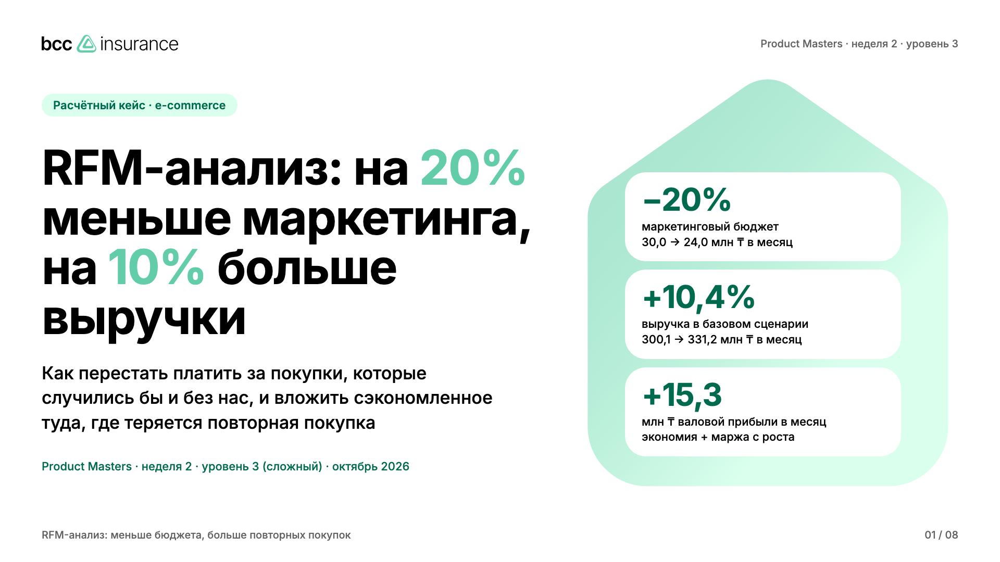
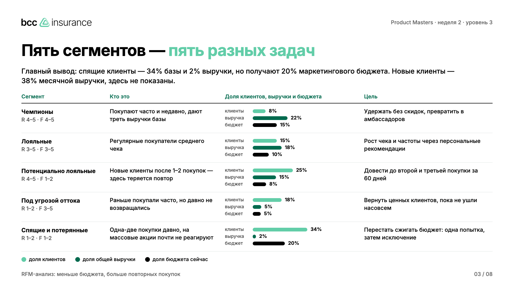
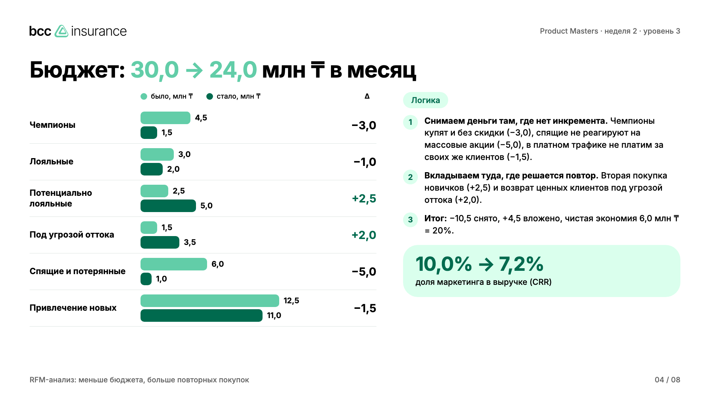
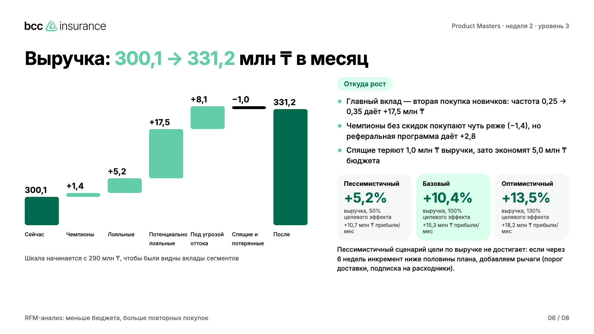
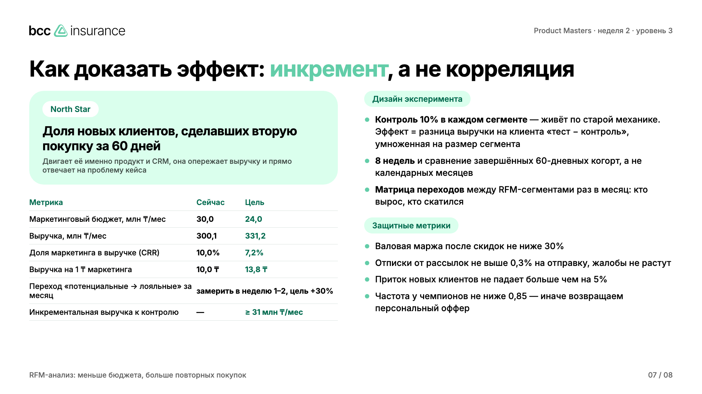

# Product Masters · Неделя 2 · Уровень 3 (сложный)

**RFM-анализ: на 20% меньше маркетинга, на 10% больше выручки.** Расчётный кейс e-commerce: как с помощью RFM-сегментации перераспределить бюджет, выбрать каналы для ключевых сегментов и доказать эффект метриками.

## [PDF для сдачи (8 слайдов)](submission/RFM_Week2_Hard_bcc.pdf)



| | |
|---|---|
|  |  |
|  |  |

## Результат в трёх цифрах

| Показатель | Сейчас | После | Изменение |
|---|---|---|---|
| Маркетинговый бюджет, млн ₸/мес | 30,0 | 24,0 | **−20%** |
| Выручка, млн ₸/мес (базовый сценарий) | 300,1 | 331,2 | **+10,4%** |
| Доля маркетинга в выручке (CRR) | 10,0% | 7,2% | −2,8 п. п. |
| Валовая прибыль, млн ₸/мес | | | **+15,3** |

Сценарии: пессимистичный +5,2% (цель по выручке не достигается, план действий описан), базовый +10,4%, оптимистичный +13,5%.

## Логика решения

1. **Снимаем деньги там, где нет инкремента.** Чемпионы купят и без скидки (−3,0 млн ₸), спящие клиенты занимают 34% базы, дают 2% выручки, но получают 20% бюджета (−5,0), в платном трафике перестаём платить за показы своим клиентам (−1,5).
2. **Вкладываем туда, где теряется повторная покупка.** Вторая покупка новичков (+2,5) и возврат ценных клиентов из сегмента «под угрозой оттока» (+2,0).
3. **Доказываем эффект инкрементом.** 10% контрольная группа в каждом сегменте, 8 недель, сравнение завершённых 60-дневных когорт, защитные метрики (маржа, отписки, приток новых).

Полный текст с ответами на три вопроса задания: [docs/solution.md](docs/solution.md).

## Честно о данных

В кейсе нет транзакций, поэтому все исходные числа (50 000 клиентов, средние чеки, частоты, бюджет 30 млн ₸) — **допущения**, собранные в одном месте: [scripts/model.py](scripts/model.py). Excel-модель с формулами [model/rfm_budget_model.xlsx](model/rfm_budget_model.xlsx): замените мятные ячейки реальными данными, и всё пересчитается, включая проверку целей −20% / +10%.

## Состав репозитория

- `submission/` — PDF для сдачи и PNG каждого слайда
- `docs/solution.md` — решение текстом
- `model/` — Excel-модель, `model.json`, `segments.csv`
- `scripts/` — модель (Python), сборка слайдов (HTML), рендер в PDF (Playwright)
- `assets/` — шрифт Inter и логотип из дизайн-системы bcc insurance

Оформление — по брендбуку bcc insurance: белый фон, акцент Green в крупных словах, Dark Green для мелкого акцентного текста, Inter Bold + Medium, выравнивание по левому краю, форма дома на обложке.

## Сборка

```bash
pip install openpyxl==3.1.5   # для Excel-модели
npm install
npm run build                 # model.py → build_html.py → render.mjs
```

**Для сдачи:** загрузить PDF на платформу Product Masters (ссылка на GitHub — дополнительно). **Срок: 24 октября 2026 года, 23:59 (UTC+5).**
